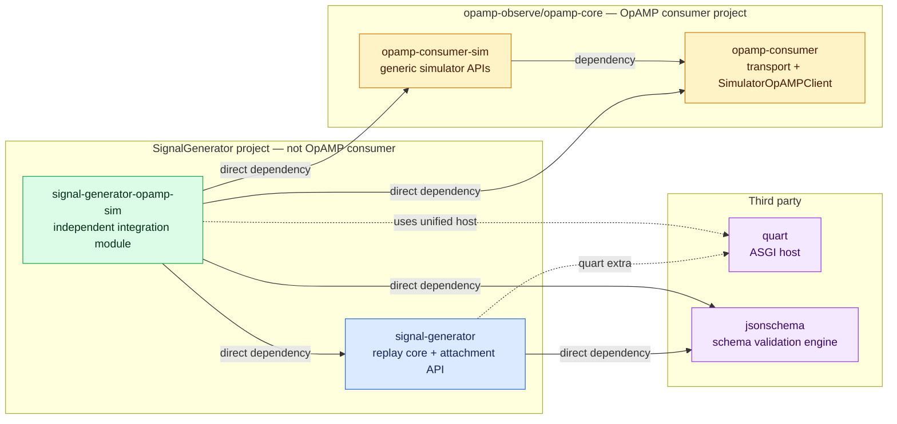
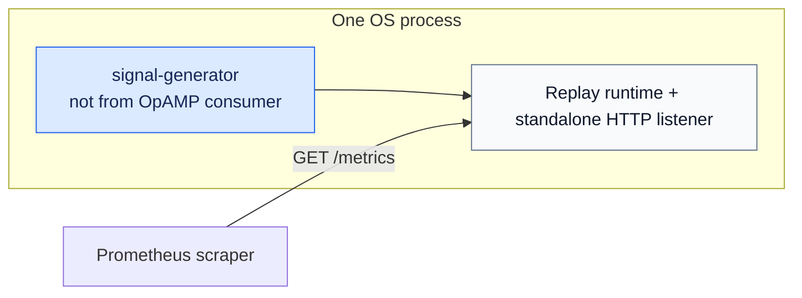
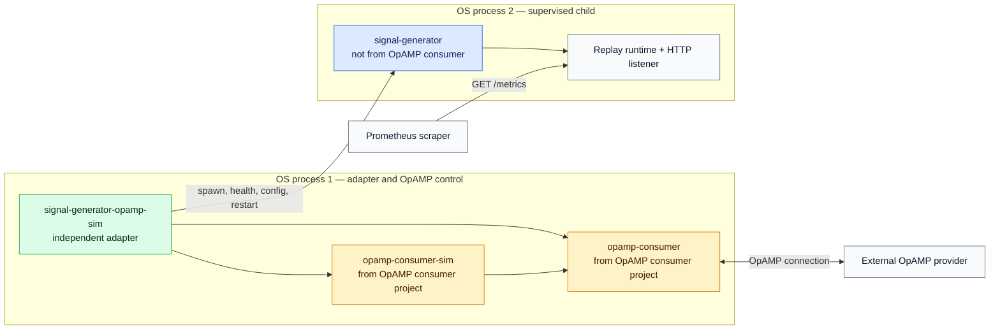
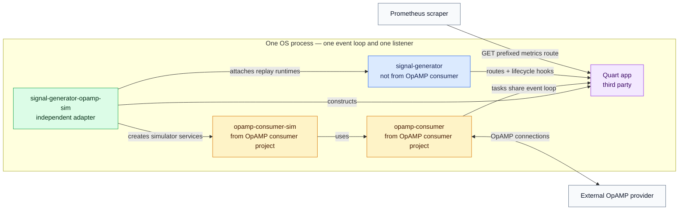
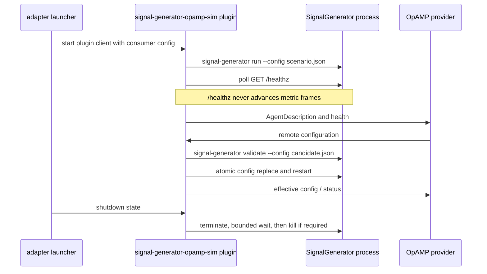
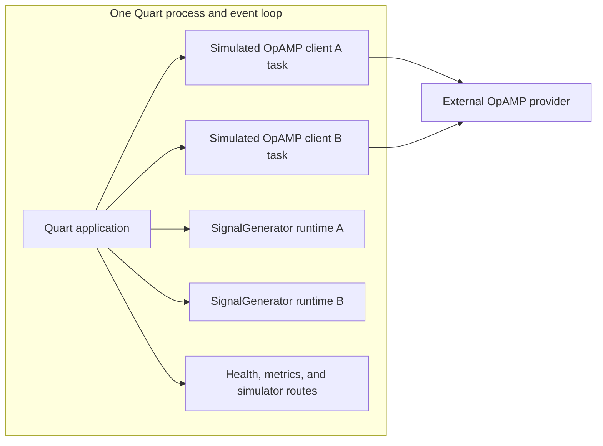

# OpAMP integration design

## 1. Boundary decision

SignalGenerator remains a standalone application and host-independent library. Its core does not
depend on [opamp-observe/opamp-core](https://github.com/opamp-observe/opamp-core), OpAMP protobufs,
or the OpAMP consumer base classes. Its optional Quart attachment module depends only on Quart's
public application and lifecycle APIs; the independent integration distribution supplies the
OpAMP-aware adapter.

The supported deployment modes are:

1. **Standalone SignalGenerator** — the console command owns its process, listener, and lifecycle;
   no OpAMP integration is present.
2. **OpAMP-supervised SignalGenerator** — an installed adapter plugin starts or observes a separate
   SignalGenerator process through the OpAMP consumer APIs. This follows the existing
   supervisor/observer model and is retained for production-like process supervision tests.
3. **Unified simulator Quart deployment** — the consumer simulator, its simulated OpAMP client
   instances, SignalGenerator runtimes, HTTP routes, and lifecycle all run in one Quart process and
   one event loop. No SignalGenerator child process, supervisor, observer, PID polling, or local
   health polling is used. This is the preferred mode when SignalGenerator is part of the simulator.

All SignalGenerator-to-OpAMP composition lives in the separately built
`signal-generator-opamp-sim` distribution. It follows the existing OpAMP consumer plugin model used
by Vector and Elastic Heartbeat:

- plugin discovery group: `opamp_consumer.plugins`,
- zero-argument plugin entry point,
- optional `process_consumer_config` hook,
- child-process lifecycle implementation,
- local health polling,
- effective and remote configuration support.

Same-process hosting is owned by the adapter distribution's Quart application. The adapter depends
on the SignalGenerator wheel and the OpAMP simulator-client packages; neither dependency contains
SignalGenerator-specific knowledge of the other.

This boundary allows SignalGenerator to release independently and prevents normal users from
installing the OpAMP stack or Quart unless their deployment needs it.

### 1.1 Package provenance and dependency view

The following table uses *OpAMP consumer project* to mean distributions built from the
[`opamp-observe/opamp-core`](https://github.com/opamp-observe/opamp-core) GitHub repository. The
adapter uses those distributions, but the adapter itself is not part of the OpAMP consumer project.

| Installed distribution or service | Source/owner | From the OpAMP consumer project? | Purpose |
|---|---|---:|---|
| `signal-generator` | This SignalGenerator project | No | Host-independent replay runtime, standalone CLI, and Quart attachment API. |
| `signal-generator-opamp-sim` | Independent module under `integrations/opamp-simulator` | No | OpAMP-aware composition, supervised plugin, unified Quart host, and adapter CLI. |
| `opamp-consumer` | [`opamp-core/consumer`](https://github.com/opamp-observe/opamp-core/tree/main/consumer) | Yes | OpAMP transport, messages, plugin APIs, and `SimulatorOpAMPClient`. |
| `opamp-consumer-sim` | [`opamp-core/consumer-sim`](https://github.com/opamp-observe/opamp-core/tree/main/consumer-sim) | Yes | Generic simulator service and launcher APIs used by the adapter. |
| `quart` | Third-party PyPI distribution | No | ASGI application and lifecycle host for unified mode. |
| `jsonschema` | Third-party PyPI distribution | No | Draft 2020-12 validation engine used by core and adapter CLIs. |
| OpAMP provider | Separately deployed service | Not a Python package in this composition | Receives simulated clients and supplies OpAMP responses/configuration; never hosts SignalGenerator. |



The adapter declares both OpAMP distributions as direct dependencies because it imports public APIs
from both. The `opamp-consumer-sim` dependency on `opamp-consumer` does not replace the adapter's
direct declaration. The dashed Quart edges show runtime hosting/extra relationships rather than
ownership.

### 1.2 Deployment permutation matrix

| Permutation | Installed application packages | OpAMP consumer packages present? | OS processes | HTTP hosting and lifecycle |
|---|---|---:|---:|---|
| Standalone | `signal-generator` | No | 1 | SignalGenerator owns its listener and process lifecycle. |
| OpAMP-supervised | All four project distributions | Yes | 2 | Adapter/OpAMP control process supervises a separate SignalGenerator process. |
| Unified simulator Quart | All four project distributions plus Quart | Yes | 1 | Adapter owns one Quart app, listener, event loop, and coordinated lifecycle. |

#### Permutation A: standalone, no OpAMP consumer packages



No adapter, `opamp-consumer`, `opamp-consumer-sim`, simulated OpAMP client, or OpAMP provider is
required in this permutation.

#### Permutation B: OpAMP-supervised, separate SignalGenerator process



This is the only permutation that uses the supervisor/observer behavior. The adapter communicates
with SignalGenerator through its CLI, process, configuration, and health contracts.

#### Permutation C: unified simulator Quart, one process



This permutation contains OpAMP consumer packages, but there is no separate consumer process and no
SignalGenerator subprocess. The adapter composes their public APIs into its Quart application. The
OpAMP provider remains external and is not a fourth hosting permutation.

## 2. Supervised-process mode



## 3. SignalGenerator-owned contract

SignalGenerator provides:

- Console command `signal-generator`.
- `run --config PATH`.
- `validate --config PATH` with stable exit codes.
- `print-effective-config --config PATH` with secret redaction.
- `--version`.
- Stable `/healthz` and `/readyz` endpoints.
- A host-independent `SignalGeneratorRuntime` with async `start()` and `stop()` lifecycle.
- Optional `signal_generator.embedding.quart:attach_signal_generator_runtime` attachment API.
- Graceful `SIGTERM` handling.
- An executable path that may be a bare PATH command or an absolute path.
- Versioned JSON configuration suitable for OpAMP remote configuration.

SignalGenerator does not know the OpAMP server URL, capabilities, message types, or launcher state
file. The separate adapter supplies OpAMP configuration and calls only SignalGenerator's public
library API.

## 4. Separate adapter distribution

The adapter is an independently versioned Python distribution with its own build, tests, wheel, and
container entry point. Proposed repository layout:

```text
integrations/opamp-simulator/
  pyproject.toml
  README.md
  src/signal_generator_opamp_sim/
    __init__.py
    cli.py
    config.py
    supervised_plugin.py
    quart_app.py
    simulator_instance.py
    lifecycle.py
    schemas/
      unified_config.schema.json
  tests/
    unit/
    contract/
    integration/
```

The distribution metadata owns the plugin and unified-host entry points:

```toml
[build-system]
requires = ["setuptools>=82", "wheel"]
build-backend = "setuptools.build_meta"

[project]
name = "signal-generator-opamp-sim"
version = "0.1.0"
requires-python = ">=3.10"
dependencies = [
  "signal-generator>=0.1.0,<0.2.0",
  "jsonschema>=4.23",
  "opamp-consumer>=0.6.0,<0.7.0",
  "opamp-consumer-sim>=0.6.0,<0.7.0",
]

[project.optional-dependencies]
unified = ["quart>=0.19.4"]

[project.scripts]
signal-generator-opamp-sim = "signal_generator_opamp_sim.cli:main"

[project.entry-points."opamp_consumer.plugins"]
signal_generator = "signal_generator_opamp_sim.supervised_plugin:main"
```

`opamp-consumer-sim` currently depends on `opamp-consumer`, while the concrete
`SimulatorOpAMPClient` is implemented in `opamp-consumer`. The adapter declares both dependencies
because it imports APIs from both; it must not rely on a transitive dependency for imported types.
The base adapter install supports supervised mode without Quart. Unified mode is installed as
`signal-generator-opamp-sim[unified]`; modules that import Quart fail with an actionable
missing-extra error when that extra is absent.

`opamp-core`'s existing installed-plugin discovery loads the supervised entry point without a built-in
registry change. The unified Quart console command belongs only to the adapter distribution.

## 5. Proposed consumer configuration

```json
{
  "consumer": {
    "server_url": "http://localhost:8080",
    "transport": "http",
    "service_type": "signal_generator",
    "service_name": "SignalGenerator",
    "service_namespace": "Demo",
    "agent_config_path": "../../SignalGenerator-Python/demo/nginx/config.json",
    "agent_additional_params": [],
    "heartbeat_frequency": 5,
    "client_status_port": 9108,
    "signal_generator": {
      "executable_path": "signal-generator",
      "health_host": "127.0.0.1",
      "health_port": 9108,
      "status_timeout_seconds": 5,
      "shutdown_timeout_seconds": 10
    }
  }
}
```

Configuration precedence for adapter-owned settings:

1. Explicit CLI override where the shared consumer supports one.
2. Environment variable.
3. `consumer.signal_generator` block.
4. Adapter default.

Proposed environment variables:

- `OPAMP_SIGNAL_GENERATOR_EXECUTABLE_PATH`
- `OPAMP_SIGNAL_GENERATOR_HEALTH_HOST`
- `OPAMP_SIGNAL_GENERATOR_HEALTH_PORT`

Paths resolve relative to the OpAMP consumer configuration file using the existing plugin-config
helpers.

## 6. Adapter responsibilities

### 6.1 Configuration hook

`process_consumer_config(context)` reads `consumer.signal_generator` and returns plugin-owned
`ConsumerConfig` fields such as executable path, health host, health port, and timeouts. It must use
`resolve_optional_executable_from_config` for a path-like executable.

### 6.2 Process lifecycle

The lifecycle builds an argv array without invoking a shell:

```text
<executable> run --config <agent_config_path> <agent_additional_params>
```

It starts the process, tracks its PID through existing consumer lifecycle data, sends terminate on
shutdown/restart, waits for a bounded interval, and kills only after timeout.

### 6.3 Health

The plugin polls `/healthz`. It must never poll the configured metrics path, because every metrics
scrape deliberately advances the pull cursor.

Healthy means:

- child process is alive,
- `/healthz` returns 200 within the timeout.

Readiness may be included in status text, but an temporarily unready source should be reported
without pretending the process is absent.

### 6.4 Version and description

- Run `<executable> --version` with a short timeout.
- Report service type `SignalGenerator`.
- Use the configured service instance identifier or the shared stable-ID mechanism.
- Do not derive identity from volatile PID or port values.

### 6.5 Configuration metadata

`config_metadata.py` reads `agent_config_path`, returns the exact configuration text as effective
configuration, and calculates the existing OpAMP config hash/version metadata. Secret references
remain references; resolved secret values must never be reported.

### 6.6 Remote configuration

The preferred update sequence is:

1. Write the received payload to a candidate file beside the active config.
2. Run `signal-generator validate --config <candidate>`.
3. Reject and report validation output if validation fails.
4. Atomically replace the active file if validation succeeds.
5. Restart the child through the lifecycle.
6. Wait for `/readyz` within a bounded timeout.
7. Report effective configuration and healthy status.

Rollback should restore the previous file if the restarted process does not become ready. The adapter
must preserve `opamp-core`'s existing previous-config and remote-config status conventions.

## 7. Capabilities

Proposed supported capabilities:

- All mandatory consumer capabilities.
- `ReportsHeartbeat`.
- `AcceptsRemoteConfig`.
- `ReportsEffectiveConfig`.
- `AcceptsRestartCommand` through the mandatory/shared behavior.

The adapter should not claim telemetry-reporting capabilities merely because the supervised process
emits Prometheus metrics.

## 8. Adapter launch and dependency model

The existing `opamp-consumer-sim` launcher remains unchanged. It neither gains a SignalGenerator
entrypoint nor imports the adapter. The adapter distribution supplies its own console command:

```text
signal-generator-opamp-sim validate --config adapter.json [--format text|json] [--schema-only]
signal-generator-opamp-sim supervised --config adapter.json
signal-generator-opamp-sim unified --config adapter.json
```

Adapter validation uses its packaged Draft 2020-12 schema and the same versioned diagnostic
envelope as SignalGenerator. Full validation also loads referenced consumer, response-plan, and
SignalGenerator scenario files through their public validation APIs. It does not bind Quart, start
a subprocess, or connect an OpAMP client. `--schema-only` validates only the adapter document.

In supervised mode, installed entry-point discovery in `opamp-consumer` loads
`signal_generator_opamp_sim.supervised_plugin:main`. No built-in registry edit is required.

In unified mode, the adapter CLI creates the Quart app and composes:

- the public embeddable simulator-client API from its OpAMP dependency,
- SignalGenerator's public runtime attachment API,
- adapter-owned schema, ownership, route, and lifecycle logic.

The adapter must depend on released package APIs, not import from a sibling source checkout. Local
development may install editable dependencies, but build and contract tests use wheels.

`APP_ENABLE_DEV_FEATURES=true` remains mandatory for simulated clients. The adapter validates this
gate before binding its listener or connecting an agent.

## 9. Packaging choices

Preferred development setup:

- Install `signal-generator-opamp-sim[dev]`; its metadata installs compatible SignalGenerator and
  OpAMP simulator dependencies.
- The adapter defaults to the `signal-generator` console command on PATH in supervised mode.
- Tests can override the executable with an absolute path.

Container deployments may either:

- build a unified image from the adapter wheel and its locked dependencies, or
- run the adapter's supervised mode with SignalGenerator as a child process.

The supervised child remains appropriate when testing the established Vector/Elastic-style process
model. The simulator integration should implement unified Quart mode first so its SignalGenerator
functionality is genuinely in-process. The provider is never a SignalGenerator host.

## 10. Integration-module test plan

Tests owned by `signal-generator-opamp-sim`:

- Plugin entry-point discovery.
- Config hook defaults, path resolution, and environment precedence.
- Correct child argv without shell execution.
- Launch, terminate, forced timeout, and restart.
- Version extraction.
- Health polling uses `/healthz` and never `/metrics`.
- Agent description service type.
- Effective-config reporting and secret non-disclosure.
- Valid remote config replacement and restart.
- Invalid remote config rejection without replacing the active config.
- Failed restart rollback.
- Adapter CLI and schema behavior.
- Unified Quart app creation with no subprocess calls.
- Multiple simulated clients sharing one event loop and listener.
- Per-instance and shared SignalGenerator runtime configuration.
- Logical restart and remote-config behavior without process restart.
- Ordered cancellation of simulator and replay tasks during Quart shutdown.
- Route-prefix uniqueness and app-scoped extension state.

Cross-repository contract test:

1. Build/install the SignalGenerator wheel.
2. Build/install compatible `opamp-consumer` and `opamp-consumer-sim` wheels.
3. Build/install the adapter wheel without source-tree path injection.
4. Start the adapter against an OpAMP test provider.
5. Confirm agent registration and health.
6. Apply a scenario change through remote configuration.
7. Confirm restart, readiness, and changed metric output.

Tests owned by `opamp-core` are limited to the generic embeddable simulator-client lifecycle and API
contracts. Installed discovery of the SignalGenerator adapter is tested by the adapter distribution;
`opamp-core` tests must not mention SignalGenerator.

## 11. Documentation requirements

The adapter distribution must document:

- installation of the SignalGenerator package,
- complete consumer configuration,
- simulator launcher configuration,
- process and health behavior,
- remote config and rollback behavior,
- capability claims,
- development-only scope,
- troubleshooting for executable discovery, port conflicts, and invalid scenarios.

`opamp-core` documents only its generic public simulator-client API and compatibility guarantees.

SignalGenerator documentation links to the OpAMP guide but does not duplicate OpAMP protocol
details.

## 12. Provider boundary

The OpAMP provider must not install, register, host, configure, or lifecycle-manage SignalGenerator.
Provider `component-entry-points.quart`, provider routes, provider images, and provider configuration
remain unchanged. SignalGenerator runs either separately or inside the unified consumer-simulator
Quart process and connects to the provider only through the simulated OpAMP client protocol.

## 13. Unified simulator Quart deployment

### 13.1 Topology

This mode combines all simulator-side functionality in one deployment:



The OpAMP provider remains the external server to which simulated clients connect. "Single
deployment" means the consumer simulator and SignalGenerator capabilities share one process; it
does not require embedding the OpAMP server into its own simulated client.

The Quart server must run with one worker. Multiple worker processes would duplicate simulated
agents, replay cursors, pushes, and log output. Horizontal scaling uses explicitly partitioned
instance configuration, not additional transparent web workers.

### 13.2 Simulator refactoring

The current simulator client `main()` and launcher own process startup. Unified mode requires an
embeddable async service boundary:

```text
SimulatorInstance.start() -> awaitable
SimulatorInstance.stop() -> awaitable
SimulatorInstance.apply_config(candidate) -> awaitable result
SimulatorInstance.health() -> immutable status
```

Required generic OpAMP simulator-client API work:

1. Expose an embeddable async simulator service from `opamp-consumer-sim`, backed by the existing
   `SimulatorOpAMPClient` in `opamp-consumer`.
2. Separate argument parsing and `asyncio.run` from simulator behavior.
3. Make connection, heartbeat, scripted-response, and shutdown loops cancellable through a stable
   lifecycle protocol.
4. Export configuration, identity, response-plan, health, and logical-restart types as public APIs.
5. Add API contract tests and semantic-versioning coverage without any SignalGenerator references.

The separate adapter distribution then:

1. Implements `signal_generator_opamp_sim.quart_app.create_app(config_path)`.
2. Stores simulator and replay registries in `app.extensions`, never module globals.
3. Constructs every configured simulator service and SignalGenerator runtime before serving.
4. Starts all tasks from `app.before_serving` and awaits shutdown from `app.after_serving`.
5. Enforces `APP_ENABLE_DEV_FEATURES=true`.
6. Owns unified configuration, route composition, failure isolation, and container startup.

The existing `opamp-consumer-sim` process launcher remains unchanged. Shared consumer transport and
message-building code stay in `opamp-core`; all SignalGenerator-aware lifecycle ownership stays in the
adapter.

### 13.3 SignalGenerator embedding API

The adapter consumes the lower-level SignalGenerator factory that supports multiple runtimes:

```text
attach_signal_generator_runtime(
    app,
    *,
    runtime_id,
    config,
    route_prefix,
) -> SignalGeneratorRuntime
```

It registers a uniquely named Blueprint and app-scoped runtime without adding process signal
handlers, opening another listener, or calling `asyncio.run`. Runtime identifiers and route
prefixes must be unique.

A simulator instance may reference:

- its own runtime for independent cursors and scenario state, or
- a named shared runtime when several simulated agents should represent one signal source.

### 13.4 Unified configuration

Illustrative `signal-generator-opamp-sim` configuration:

```json
{
  "mode": "unified_quart",
  "quart": {
    "host": "0.0.0.0",
    "port": 9108,
    "workers": 1
  },
  "signal_generator_runtimes": [
    {
      "id": "nginx-a",
      "config_path": "../../SignalGenerator-Python/demo/nginx/config.json",
      "route_prefix": "/signal-generator/nginx-a"
    }
  ],
  "instances": [
    {
      "name": "simulator-a",
      "consumer_config_path": "../../consumer/opamp-simulator.json",
      "responses_path": "../../consumer/simulator-responses.example.json",
      "signal_generator_runtime": "nginx-a",
      "identity": {
        "service_instance_uid": "simulator-a",
        "client_version": "2.0.0",
        "config_version": "nginx-demo-1"
      }
    }
  ]
}
```

The packaged JSON Schema validates structural fields before Quart binds. The semantic validation
stage checks unique instance names, runtime IDs, route prefixes, service instance IDs, and port
ownership. Relative paths resolve from this configuration file. The adapter's `validate` command
reports these failures with stable codes, JSON Pointers, actionable hints, and text or JSON output.

### 13.5 Lifecycle and failure behavior

Startup order:

1. Load and validate simulator, response-plan, and SignalGenerator configurations.
2. Build Quart routes and app-scoped registries.
3. Bind the Quart listener.
4. Start SignalGenerator runtimes.
5. Start simulated OpAMP clients.
6. Mark aggregate readiness when required runtimes and clients are ready.

Shutdown reverses the ownership order: simulated clients stop sending and disconnect, replay tasks
stop and flush, then Quart completes shutdown. Each wait is bounded, but no task is abandoned.

The default failure policy isolates one simulator/runtime pair and reports it unhealthy while other
instances continue. A `fail_host` policy is available for tests that require all-or-nothing startup.

### 13.6 Restart and remote configuration

There is no child process to restart. Restart means a logical lifecycle transition:

1. Mark the instance unready.
2. Stop its simulated client tasks.
3. Stop and flush its owned SignalGenerator runtime, if any.
4. Apply validated configuration atomically.
5. Recreate cursors and tasks according to the configured resume policy.
6. Reconnect the simulated client and mark it ready.

Shared runtimes cannot be restarted implicitly by one attached simulated client. Their configuration
declares an owner or requires an explicit host-level operation. This prevents one OpAMP command from
disrupting unrelated clients.

Remote configuration is validated in memory through library APIs; unified mode must not spawn the
`signal-generator validate` CLI. Effective configuration and rollback rules remain the same as the
process mode.

### 13.7 Health and routes

Host routes:

- `/healthz` for Quart-process liveness.
- `/readyz` for aggregate readiness.
- `/api/simulator/instances` for per-instance state in development mode.
- `/signal-generator/<runtime-id>/metrics` for replay metrics.
- `/signal-generator/<runtime-id>/healthz` and `/readyz` for runtime state.

The simulator reads runtime health directly from the in-memory object. It must not poll HTTP routes
inside its own process, and it must never scrape a metrics route to determine health.

### 13.8 Launcher and state changes

`signal-generator-opamp-sim unified` runs the Quart app in the foreground. Container or
operating-system signals stop it. The adapter does not use the existing consumer-sim
PID/process-group state file, and the original launcher behavior remains unchanged.

If a `stop` command is retained for local convenience, it targets a development-only authenticated
control endpoint or sends a signal to the single recorded host PID. It does not enumerate or kill
SignalGenerator children because none exist.

### 13.9 Verification

Tests must prove:

- exactly one host process and listener,
- zero SignalGenerator subprocess launches,
- no observer/process-tracking mode is selected,
- multiple simulated clients connect independently,
- independent and shared runtime mappings behave as configured,
- health reads are in-memory and do not consume frames,
- logical restart affects only the intended ownership scope,
- remote-config rollback restores the prior in-memory runtime,
- task exceptions are collected and reflected in readiness,
- shutdown leaves no pending tasks or open output resources.


