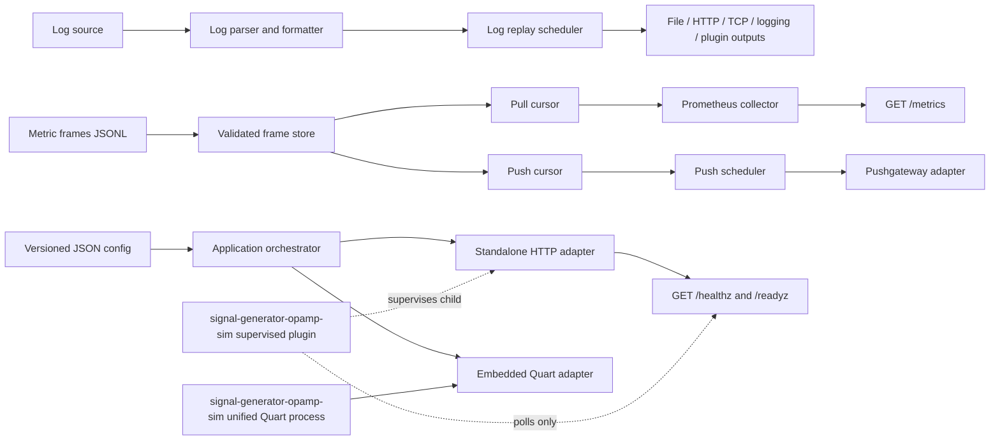

# Solution design

## 1. Purpose

SignalGenerator Python will be an enhanced Python implementation of
[mp3monster/LogGenerator](https://github.com/mp3monster/LogGenerator). It will preserve the
original tool's core purpose—replaying log events from source data into configurable outputs—and
add deterministic Prometheus metrics replay.

The original tool supports file, HTTP, TCP, Java logging, standard output, standard error, and
custom output destinations. Its timing is driven by source timestamps or a default offset, with
repeat and acceleration controls. The Python implementation should retain those concepts while
using a versioned configuration model and replaceable Python interfaces.

## 2. Goals

- Replay log events from files with deterministic ordering and timing.
- Read existing log files and time-shift their timestamps so they appear current while preserving
  the original relative intervals.
- Support the original formatting concepts, including `%t`, `%m`, `%l`, `%p`, `%c`, `%i`, and `%j`.
- Provide file, HTTP, TCP, Python logging, Java-util-logging-compatible formatted output, stdout,
  stderr, and plugin-provided log outputs.
- Read Prometheus metric snapshots from a JSON Lines file where one line is one complete frame.
- Expose the next metric frame on every successful scrape of the configured metrics path.
- Push metric frames on a configured interval.
- Keep pull and push replay deterministic when both modes run together.
- Provide health and readiness endpoints that never consume metric frames.
- Provide a container and a reproducible NGINX metrics replay demonstration.
- Expose stable process, configuration, and health contracts for an independently built OpAMP
  simulator adapter.
- Keep OpAMP-specific composition in a separately built adapter module; SignalGenerator core and
  `opamp-observe/opamp-core` contain no SignalGenerator-specific cross-project extension logic.
- Provide strong unit, contract, integration, and container end-to-end coverage.
- Reserve stable interfaces and configuration namespaces for trace-payload replay under
  [SG-012](roadmap.md), without claiming current trace support.
- Replay every enabled signal type from one service and one coordinated lifecycle.
- Provide documented reference configurations for common log formats.
- Generate operational SignalGenerator metrics and allow them to be included in test output.
- Release scheduled signals in timestamp order when source timing is available.
- Optionally loop source files for long-running replay scenarios.
- Support both a standalone process and in-process attachment to the unified consumer-simulator
  Quart application.
- Ship as a standards-compliant wheel from a canonical TOML project definition.
- Enforce test coverage and cyclomatic-complexity quality gates.
- Provide schema-backed CLI validation with actionable human diagnostics and stable JSON output.

## 3. Non-goals for the first release

- Generating synthetic metric values from distributions. Values are replayed from JSON Lines.
- Acting as a Prometheus server or long-term metrics store.
- Replacing Prometheus, Pushgateway, or an OpenTelemetry Collector.
- Coupling the core package to OpAMP protocol libraries.
- Guaranteeing compatibility with arbitrary Groovy custom outputter classes.
- Using the simulator as a production telemetry agent.
- Building a user interface.

## 4. Key terminology

| Term | Meaning |
|---|---|
| Event | One input log record after source parsing. |
| Log replay | Timed delivery of events to one or more log outputs. |
| Metric frame | The complete set of metric families and samples represented by one JSONL line. |
| Cursor | The independently tracked next frame for a replay consumer. |
| Pull cursor | Cursor advanced by requests to the metrics endpoint. |
| Push cursor | Cursor advanced by successful scheduled pushes. |
| Cycle | One complete pass through a source file. |
| OpAMP simulator adapter | Independently built integration distribution for child-process supervision or unified hosting. |
| Embedded mode | SignalGenerator runtime and routes hosted inside the unified simulator Quart process. |
| Signal envelope | Internal scheduled item carrying signal type, source time, and payload. |

## 5. Architecture



The log and metric paths share configuration, lifecycle, diagnostics, and shutdown handling. They
do not share source cursors or timing state.

The application core must not depend on its HTTP host. `SignalGeneratorRuntime` owns configuration,
sources, cursors, schedulers, and lifecycle. A standalone adapter supplies its own HTTP server; an
embedded adapter registers routes and lifecycle hooks on the unified consumer-simulator Quart app.

## 6. Package structure

```text
src/signal_generator/
  __init__.py
  __main__.py
  cli.py
  application.py
  lifecycle.py
  diagnostics.py
  signals.py
  config/
    __init__.py
    models.py
    loader.py
    validation.py
    legacy_properties.py
  logs/
    __init__.py
    models.py
    source.py
    parser.py
    formatter.py
    scheduler.py
    registry.py
    outputs/
      base.py
      file.py
      http.py
      tcp.py
      python_logging.py
      streams.py
  metrics/
    __init__.py
    models.py
    jsonl_source.py
    validation.py
    frame_store.py
    cursor.py
    collector.py
    exposition.py
    push.py
    scheduler.py
  health/
    __init__.py
    application.py
  embedding/
    __init__.py
    quart.py
tests/
  unit/
  contract/
  integration/
  e2e/
demo/nginx/
  config.json
  nginx_metrics.jsonl
  prometheus.yml
  compose.yml
docs/
```

The folders describe responsibility boundaries, not a mandate for one class per file. Small modules
may be combined when that makes the implementation clearer.

`signals.py` defines a small signal envelope and source/sink protocols shared by scheduled signal
types. Logs implement the first scheduled signal type. Push metrics can participate when frames
contain source timing; pull metrics remain demand-driven because a scrape is the required advance
trigger. The trace namespace is reserved in configuration and protocols, but no trace parser,
transport, or dependency is shipped until that feature is designed.

## 7. Process lifecycle

1. Parse CLI arguments.
2. Load the versioned configuration file.
3. Resolve relative paths against the configuration file's directory.
4. Apply environment and CLI overrides.
5. Validate the complete configuration against its versioned JSON Schema and semantic rules before
   opening outputs or ports.
6. Load and validate source files.
7. Start health/readiness handling.
8. Start enabled replay tasks:
   - log scheduler,
   - pull exposition server,
   - push scheduler.
9. Mark readiness only after all enabled sources and required listeners are ready.
10. On `SIGINT` or `SIGTERM`, stop accepting work, allow bounded in-flight completion, close
    outputs, stop the HTTP server, and return a meaningful exit status.

Partial startup must unwind already-created resources. A configuration error must fail before any
events or metric frames are emitted.

The same validation pipeline is exposed by `signal-generator validate`. Startup and CLI validation
must not maintain separate rule sets: both call the packaged schema validator and semantic
validation service described in [configuration_design.md](configuration_design.md).

## 8. Log replay design

### 8.1 Compatibility model

The primary configuration is the versioned JSON format described in
[configuration_design.md](configuration_design.md). A legacy `.properties` adapter maps the
original uppercase keys into the new model.

Initial compatibility mappings include:

| Original key | New model |
|---|---|
| `SOURCE` | `logs.source.path` |
| `SOURCEFORMAT` | `logs.source.format` |
| `SOURCEDTG` | `logs.source.datetime_format` |
| `TARGETFORMAT` | `logs.format` |
| `TARGETDTG` | `logs.datetime_format` |
| `OUTPUTTYPE` | `logs.outputs[].type` |
| `TARGETFILE` | file output path |
| `TARGETIP`, `TARGETPORT` | TCP output host and port |
| `TARGETURL` | HTTP output URL |
| `REPEAT` | `logs.replay.cycles` |
| `ACCELERATEBY` | `logs.replay.acceleration` |
| `DEFAULTTIMEOFFSET` | `logs.replay.default_interval_ms` |
| `FIRSTOFMULTILINEREGEX` | `logs.source.multiline.first_line_pattern` |
| `ALLOWNL` | `logs.source.unescape_newlines` |
| `CUSTOMOUTPUT` | named Python output plugin |

Unknown legacy keys should produce a warning by default and an error in strict validation mode.

### 8.2 Timing

- A source-relative `+N` time value means an `N` millisecond delay from the previous event.
- Absolute source timestamps derive the delay between adjacent records.
- `default_interval_ms` applies when the source has no timing value.
- `acceleration` divides the derived delay and must be greater than zero.
- A monotonic clock drives waits; wall-clock changes must not alter replay spacing.
- An injectable clock and sleeper make timing unit tests deterministic.
- Cancellation interrupts waits cleanly.

### 8.3 Outputs

Every output implements a small lifecycle protocol:

```text
open() -> None
write(event: RenderedLogEvent) -> None
flush() -> None
close() -> None
```

Async implementations may expose equivalent awaitable methods behind the same application-facing
adapter. Output failures follow an explicit policy: `fail`, `retry`, or `continue`. The default is
`fail` to avoid silently losing test data.

Custom log outputs are discovered through Python package entry points under
`signal_generator.log_outputs`. Configuration selects a plugin by name; it must not import or
execute arbitrary file paths from untrusted configuration.

### 8.4 Reference scenario catalog

Checked-in reference scenarios combine a source fixture, configuration, expected rendered events,
and short usage document. The initial catalog covers:

- NGINX/Apache common and combined access logs,
- RFC 3164 and RFC 5424 syslog,
- one-event-per-line JSON logs,
- Java util logging-style text,
- Python logging-style text,
- multiline Java/Python stack traces,
- generic delimited application logs,
- time-shifted and accelerated variants of the timestamped formats.

Every scenario is executable in standalone and container tests. Formats are data-driven examples,
not hard-coded parser modes unless a format requires semantics the token parser cannot express.
Documentation identifies expected fidelity and any deliberate difference from the original Groovy
tool.

## 9. Metrics replay design

### 9.1 Frame loading

- The JSONL file is opened during startup and validated line by line.
- Blank lines are ignored; comments are not allowed because the file is JSON Lines.
- Validation errors include the path, one-based line number, and field location.
- Frames are indexed once so independent cursors can replay the same data.
- The first implementation keeps validated frames in memory. Indexed storage is tracked as
  [SG-007](roadmap.md) without changing the cursor contract.
- At least one frame is required when pull or push is enabled.

### 9.2 Stable metric descriptors

Across all frames, a metric name must retain the same:

- metric type,
- help text,
- label-name set,
- histogram bucket boundaries where applicable.

Label values and sample values may change. Descriptor drift is a startup error, not a scrape-time
surprise.

### 9.3 Pull sequence semantics

Only a successful request to the configured metrics path consumes a pull frame.

```text
request 1 -> frame 1
request 2 -> frame 2
request 3 -> frame 3
request 4 -> frame 1 when EOF policy is loop
```

The server acquires the next frame under a short lock, releases the lock, and renders an immutable
snapshot. Concurrent scrapes therefore receive distinct frames in a defined sequence. If a client
disconnects after the snapshot is assigned, that frame remains consumed; attempting to infer
whether a remote scraper received every byte would make behavior nondeterministic.

Requests to `/`, `/healthz`, and `/readyz` never advance the cursor. Unsupported methods and paths
never advance it. A rendering failure increments an internal error metric and returns HTTP 500.

### 9.4 Pull and push independence

Pull and push use separate cursors by default. This prevents a scheduled push from causing a
Prometheus scrape to skip a frame, and prevents extra diagnostic scrapes from changing the pushed
sequence.

An optional shared-cursor mode is tracked as [SG-006](roadmap.md); it is excluded from the first
release because its race behavior is difficult to reason about and test.

### 9.5 End-of-file policy

Each cursor has one of these policies:

| Policy | Behavior |
|---|---|
| `loop` | Continue from frame 1. Default for demonstrations. |
| `hold_last` | Continue returning or pushing the final frame. |
| `stop` | Pull returns 410 after the last frame; push task exits successfully. |
| `error` | Treat the next read after the final frame as a runtime failure. |

Cursor cycle and frame indexes are exposed as SignalGenerator self-metrics.

### 9.6 Prometheus rendering

Use a custom collector and isolated `CollectorRegistry` from `prometheus_client`. Do not mutate the
process-global registry and do not model snapshot counters by repeatedly calling `Counter.inc()`.
A custom collector can render the exact counter, gauge, histogram, summary, info, or untyped values
represented by the current frame.

Source timestamps are metadata by default. Prometheus should timestamp samples at scrape/ingest
time. Explicit sample timestamps are [SG-015](roadmap.md) and require a proven use case that
justifies the stale-sample and out-of-order risks.

Prometheus text exposition is implemented. Explicit OpenMetrics negotiation is
[SG-002](roadmap.md).

### 9.7 Push semantics

Prometheus normally scrapes targets. The first push implementation therefore targets a
Pushgateway-compatible endpoint, which is the conventional bridge for short-lived or batch jobs.
The configuration names this protocol explicitly as `pushgateway`; it does not imply that an
ordinary Prometheus server accepts text exposition pushes.

The push scheduler:

1. Selects the current push frame.
2. Renders it into an isolated registry.
3. Sends it using the configured job and grouping key.
4. Advances only after a successful response.
5. Retries the same frame after a bounded exponential backoff on transient failure.
6. Applies the configured interval between successful pushes.

Direct Prometheus remote write is tracked as [SG-004](roadmap.md) because it requires a different
wire protocol, authentication model, timestamp policy, and dependency set. The push interface makes
that adapter possible without changing frame loading or scheduling.

### 9.8 Self-observability

Self-metrics use a reserved `signal_generator_` prefix and include:

- `signal_generator_info`
- `signal_generator_ready`
- `signal_generator_metric_frames_total`
- `signal_generator_metric_frame_index`
- `signal_generator_metric_cycles_total`
- `signal_generator_metric_scrapes_total`
- `signal_generator_metric_pushes_total`
- `signal_generator_metric_push_failures_total`
- `signal_generator_log_events_emitted_total`
- `signal_generator_log_output_failures_total`

Self-metrics do not come from the frame file and do not change descriptor validation.

## 10. HTTP and health contract

Defaults:

| Method and path | Purpose | Consumes a frame |
|---|---|---|
| `GET /metrics` | Current pull frame plus self-metrics | Yes |
| `GET /healthz` | Process liveness | No |
| `GET /readyz` | Sources loaded and enabled services ready | No |
| `GET /` | Small service identity document | No |

The metrics path is configurable. Health paths remain stable so containers and the OpAMP simulator
adapter can rely on them. Health responses are small JSON objects and must not disclose secrets or
complete configuration.

The exposition server can be implemented with a small WSGI router around `prometheus_client` and a
background HTTP server. Log replay and push scheduling can use `asyncio`; blocking library calls
run through bounded worker threads. This avoids adopting a full web framework solely for four
endpoints.

## 11. Configuration precedence

Highest to lowest:

1. Explicit CLI overrides.
2. Environment variables.
3. Versioned configuration file.
4. Legacy properties mapping.
5. Code defaults.

Secrets such as HTTP authorization tokens are accepted through environment variables or referenced
secret files, not printed in effective-config output, and not included in examples.

## 12. Security and reliability

- Bind the metrics server to loopback by default; container examples explicitly bind all interfaces.
- Reject paths outside configured mount roots only when an optional restricted mode is enabled;
  otherwise resolve and log absolute paths.
- Enforce source file and line-size limits to avoid accidental memory exhaustion.
- Bound HTTP timeouts, retry counts, and backoff.
- Do not follow arbitrary redirects for pushes unless configured.
- Validate metric and label names before startup.
- Never import plugins by arbitrary filesystem path; use installed entry points.
- Run as a non-root user in the container.
- Handle signals and child supervision without shell command construction.
- Redact authorization headers and secret configuration values from logs.

## 13. Performance expectations

The primary target is deterministic functional testing, not maximum-throughput load generation.
Initial design targets are:

- 10,000 metric samples per frame without corrupting output.
- 100 concurrent scrape requests with ordered, lock-safe frame assignment.
- Log scheduling drift below one configured interval for normal local workloads.
- Bounded memory documented as approximately source-frame size plus parsed representation.

Benchmarks inform [SG-007](roadmap.md) and other optimization work. Correct sequencing and clear
failure behavior take priority over speculative micro-optimizations.

## 14. Deployment modes

### 14.1 Standalone process

The `signal-generator run` command owns the replay runtime and its HTTP listener. This mode is used
by the standalone container and by the `signal-generator-opamp-sim` supervised plugin when
child-process supervision is required. It exposes the configured root routes (`/metrics`,
`/healthz`, and `/readyz`) and handles operating-system signals directly.

### 14.2 Unified simulator Quart component

The `quart` optional dependency exposes a lower-level attachment API:

```text
signal_generator.embedding.quart:attach_signal_generator_runtime
```

The independent adapter's unified host calls it with its Quart application, runtime ID, validated
configuration, and route prefix. The attachment:

1. Creates one `SignalGeneratorRuntime` and stores it in an app-scoped runtime registry.
2. Registers a uniquely named Blueprint under the runtime's configured prefix.
3. Starts replay tasks through `app.before_serving`.
4. Stops and awaits replay tasks through `app.after_serving`.
5. Reuses the simulator event loop, logging, listener, and signal handling.

Default embedded routes are:

| Route | Purpose |
|---|---|
| `/signal-generator/<runtime-id>/metrics` | Demand-driven replay metrics. |
| `/signal-generator/<runtime-id>/healthz` | Component liveness. |
| `/signal-generator/<runtime-id>/readyz` | Component readiness. |

The prefix is mandatory and unique in embedded mode so multiple simulated clients can own
independent runtimes without route collisions.

Embedded mode must not:

- start another HTTP server,
- install process signal handlers,
- call `asyncio.run`,
- stop the host application when a replay source completes,
- use the process-global Prometheus registry,
- replace host logging or observability configuration.

A runtime failure marks only its associated simulator/runtime ownership scope unready and cancels
those tasks. Whether the unified simulator should terminate is an explicit `failure_policy`
setting; the default is `isolate` for embedded mode and `fail_process` for standalone mode.

### 14.3 Container choices

Two supported container shapes follow from these modes:

- A dedicated SignalGenerator image running the console command.
- A unified adapter image containing the `signal-generator-opamp-sim`, SignalGenerator,
  `opamp-consumer`, and `opamp-consumer-sim` wheels, with runtimes attached by the adapter app
  factory.

The second option is one operating-system process. It is not a sidecar and does not use the
child-process consumer lifecycle.

## 15. Multi-signal timing and replay

Timestamped scheduled sources normalize records into a `SignalEnvelope` containing signal type,
source timestamp, source sequence, and immutable payload. A merge scheduler orders envelopes by:

1. normalized source timestamp,
2. configured source priority,
3. stable source sequence.

Time shifting calculates one scenario offset from the earliest source timestamp to the configured
replay start (default `now`) and applies that same offset to all timestamped signals. This preserves
relative ordering across files and signal types. Acceleration scales elapsed intervals after the
offset is applied.

Looping creates a new cycle epoch. The next cycle begins after the previous cycle's final scheduled
timestamp plus the configured loop gap. It must not move timestamps backwards. Demand-driven metric
scrapes remain outside the merge scheduler. Cross-source merge behavior, including scheduled metric
pushes with `observed_at`, is tracked as [SG-001](roadmap.md).

SignalGenerator self-metrics are always available as operational metrics. Configuration may include
them in the test exposition registry, but recursive measurements such as scrape counters are
snapshotted once per response so rendering cannot recurse indefinitely.

## 16. Design decisions

| Decision | Rationale |
|---|---|
| Versioned JSON is the canonical config | Standard-library parsing, schema clarity, and easy OpAMP remote config. |
| Legacy properties are an adapter | Preserves migration without constraining the internal model. |
| One JSONL line is one complete metric frame | Matches the requested replay unit and makes sequencing deterministic. |
| Pull and push have independent cursors | Prevents cross-channel frame theft and timing races. |
| Health never uses `/metrics` | OpAMP/container polling must not alter replay. |
| Pushgateway is the initial push protocol | It is the conventional Prometheus push bridge and accepts exposition data. |
| Custom collector instead of mutable counters | Snapshot replay must expose exact source values, including resets. |
| OpAMP composition lives in an independent adapter distribution | Keeps SignalGenerator-specific code out of both core dependencies while allowing the adapter to depend on their published APIs. |
| Core runtime is host-independent | The same replay logic supports a console process and embedded Quart component. |
| Embedded routes require a runtime prefix | Allows multiple in-process simulator runtimes without collisions. |
| Complexity is a release gate | Keeps replay, validation, and lifecycle paths reviewable and testable. |
| Root `pyproject.toml` is canonical | Prevents dependency, build, and tool configuration drift. |

