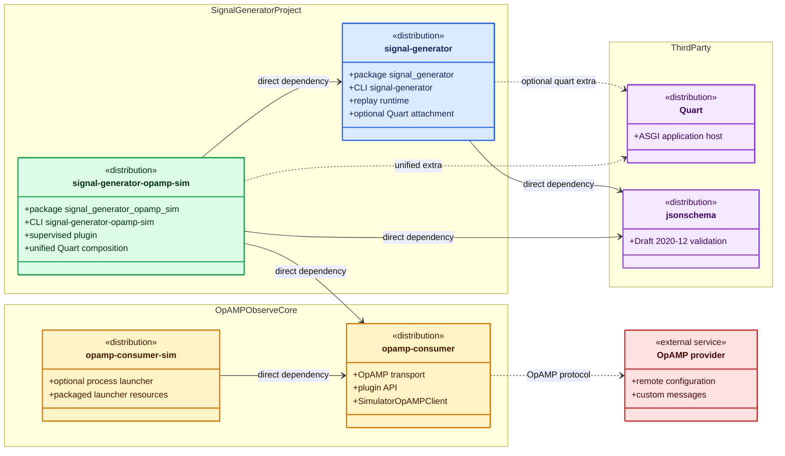
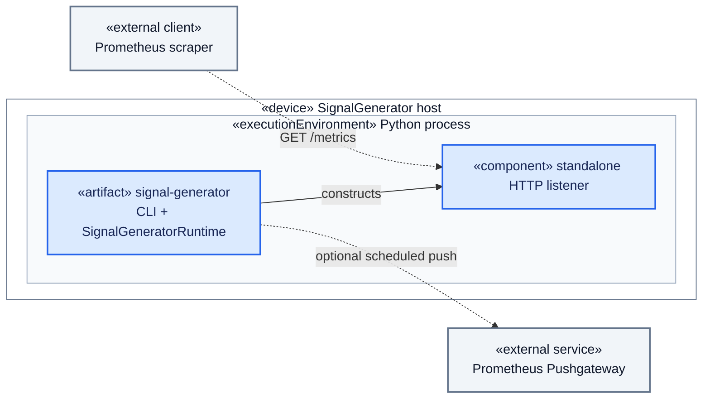
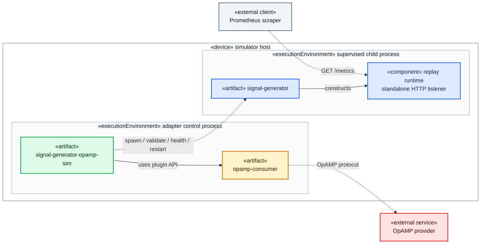
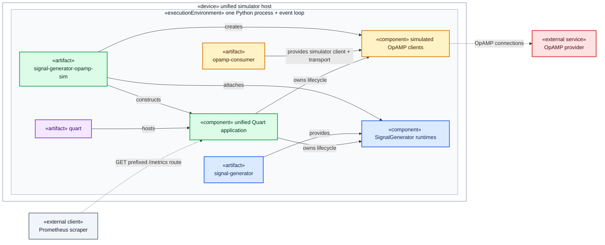

# UML package and deployment architecture

## 1. Purpose and notation

These diagrams show which installable packages belong to SignalGenerator, which come from
`opamp-observe/opamp-core`, and how those packages are deployed in each supported permutation. They
complement the behavioral flows in [solution_design.md](solution_design.md) and the detailed
integration contracts in [opamp_integration_design.md](opamp_integration_design.md).

The diagrams use UML stereotypes inside Mermaid so they render with the rest of the Markdown
documentation. Solid arrows represent package or construction dependencies. Dashed arrows represent
runtime protocols, optional attachment, or supervision rather than package ownership.

| Colour | Ownership or role |
|---|---|
| Blue | SignalGenerator core distribution and runtime |
| Green | Independently built SignalGenerator OpAMP adapter |
| Amber | Consumer packages from `opamp-observe/opamp-core` |
| Purple | Third-party Python packages |
| Grey | External clients or generic runtime infrastructure |
| Red | External OpAMP provider; never a SignalGenerator host |

## 2. UML package dependency diagram

The adapter is part of this repository but remains a separate distribution. Both amber packages are
released from `opamp-observe/opamp-core`, but only `opamp-consumer` is an adapter dependency. The
companion process launcher does not become a SignalGenerator package. The external provider
participates through the OpAMP protocol and is absent from the Python dependency graph.

## 3. UML deployment diagram: standalone utility

Only `signal-generator` is required. No adapter, OpAMP consumer package, Quart host, or OpAMP
provider participates in this deployment.

## 4. UML deployment diagram: OpAMP-supervised process

This is the only supported two-process permutation. The green adapter owns child lifecycle and
health polling. The amber consumer owns the OpAMP connection; the red provider still does not host
SignalGenerator.

## 5. UML deployment diagram: unified Quart simulator

All artifacts share one process, event loop, listener, and coordinated Quart lifecycle. There is no
SignalGenerator child, supervisor, observer, PID polling, or local health polling. The adapter is
the composition root: the blue core and amber simulator packages remain unaware of one another.

## 6. Boundary summary

| Boundary | Allowed dependency direction | Prohibited coupling |
|---|---|---|
| Core and adapter | Adapter depends on core | Core importing adapter or OpAMP packages |
| Adapter and OpAMP consumer | Adapter depends on published consumer APIs | SignalGenerator-specific code in `opamp-core` |
| Optional process launcher and consumer | `opamp-consumer-sim` depends on consumer; adapter does not depend on launcher | Provider embedding SignalGenerator |
| Quart integration | Core exposes optional attachment; adapter composes it | Core requiring Quart for CLI-only use |
| External provider | Consumer communicates over OpAMP | Provider becoming a SignalGenerator deployment mode |

